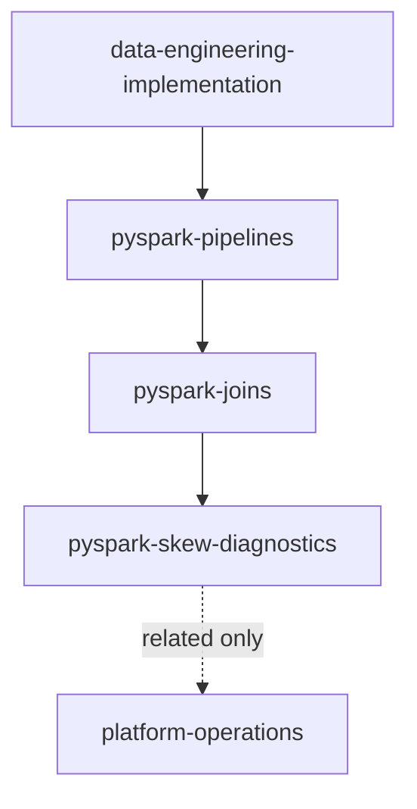

# File-backed skill graph

This repository models skills as a **typed graph with a hierarchical routing spine**, not as a graph database or a recursive prompt loader.

## Nodes and edges

- Every active SKILL.md is an independently installable Agent Skills package at .agents/skills/<id>/SKILL.md.
- Domain-local skills.json is the authoritative index for the domain. Optional parent_skill means "specializes": child -> parent (same domain, acyclic).
- Optional related_skills means "related_to": a navigation hint, possibly cross-domain; it never authorizes automatic loading or implies dependency.
- A related edge need not be symmetric. It is a navigation hint rather than a logical equivalence.
- Missing nodes, self-links, duplicate relations, and parent cycles fail registry validation. Unrecognized relation types are not supported.
- Subdomain labels in catalog/domains.json are taxonomy metadata, not independently loadable skills.

## Example graph



Inspect canonical metadata locally:

```bash
python scripts/inspect_skill_graph.py pyspark-skew-diagnostics
```

The inspector reads the whole registry for *offline maintenance* only; it is not a runtime router, skill executor, or prompt loader.

## Concrete route

A user asks: "My PySpark join has a few shuffle tasks 20 times slower than the others."

1. Parse the actual deliverable: diagnose uneven shuffle tasks; do not route on the word "Spark" alone.
2. Read catalog/domains.json and choose data.
3. Read domains/data/ROUTER.md and domains/data/skills.json only.
4. Follow the specific specialization: data-engineering-implementation -> pyspark-pipelines -> pyspark-joins -> pyspark-skew-diagnostics.
5. **Load only** pyspark-skew-diagnostics/SKILL.md, because the most specific skill is sufficient. Parents are lineage, not mandatory context.
6. Request task-level evidence. If it is absent, label skew a hypothesis and provide measurements rather than a fabricated diagnosis.
7. Load a second skill only when the user requests a distinct deliverable and explains the dependency.

A complete PySpark ETL job instead selects pyspark-pipelines. A join correctness bug selects pyspark-joins. An ordinary SQL or Kafka pipeline can stay on data-engineering-implementation.

## Cost and reliability constraints

- The root policy stays short; only one domain registry is traversed for ordinary tasks.
- Do not preload ancestors, unrelated edges, supporting references, or the complete graph.
- Avoid a runtime graph store, semantic embeddings, auto-generated reference prose, or model-rated confidence until real failure data warrants them.
- The graph proves referential integrity, not fact correctness, client compliance, routing accuracy, or token savings.
- Validate the *actual* model's selection, files loaded, response faithfulness, and token use in an agent-level harness before claiming improvements.

## Adding a deeper skill

Only add a child if it has an independently testable workflow and meaningfully different trigger and output; otherwise add a focused reference to an existing SKILL.md. Keep children as sibling skill directories so clients that scan one level can find them. Update the domain registry, test fixtures, authoring docs, and validation.
